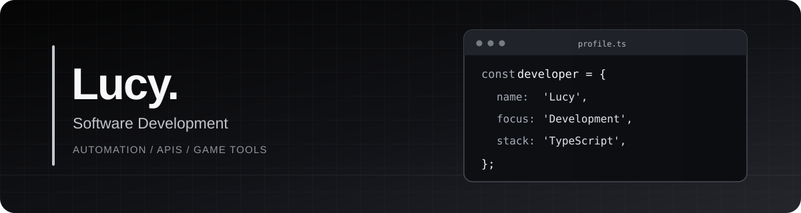

 

**A little bit of code, a little bit of chaos, and lots of pink.** 🌸

### 🌷 about me

Heya, I'm **Lucy**! I'm a developer who likes turning random ideas into actual projects — especially when they involve games, automation, or figuring out how things work under the hood.

- 🎮 I make **Bloons TD 6** tools, mods, and Discord integrations.
- 💻 I enjoy **TypeScript, Python, Rust, and C#**.
- 🛠️ Also into **Linux, homelabs, self-hosting, and infrastructure**.
- ✨ Always learning, experimenting, and finding something new to optimize.
- 🎀 My preferred aesthetic: *functional, but make it cute.*

### 🧁 tech & tools

### 💖 things I've built

<table>
<tr>
<td width="50%" valign="top">

#### 🌸 [NK-Girl](https://github.com/xLucyu/NK-Girl)

A Discord bot for **BTD6 events**, including race, boss, and Odyssey information, with custom-generated event visuals.

`TypeScript` · `Discord.js` · `PostgreSQL`

</td>
<td width="50%" valign="top">

#### 🏆 [BTD6 Boss API](https://github.com/xLucyu/BTD6-Boss-API)

A third-party API project for working with **Bloons TD 6 boss leaderboard** data.

`TypeScript` · `API`

</td>
</tr>
<tr>
<td width="50%" valign="top">

#### 🧩 [CTTileToChallenge](https://github.com/xLucyu/CTTileToChallenge)

A BTD6 mod that helps turn **Contested Territory tiles** into playable challenges.

`C#` · `Game Modding`

</td>
<td width="50%" valign="top">

#### 🎈 [CEditorBoss](https://github.com/xLucyu/CEditorBoss)

My BTD6 boss-editor modding project and a place to experiment with custom boss content.

`C#` · `Game Modding`

</td>
</tr>
</table>

### 📊 a little GitHub magic

---

*make it work · make it cute · make it faster* ✨

Thanks for visiting my little corner of GitHub! ♡

